<div align="center">

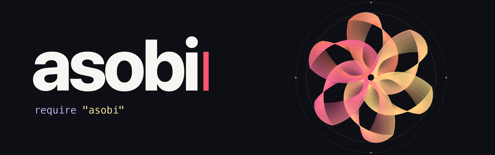

[English](README.md) · **日本語**

# Object to Art. Art to Object.

**asobi（遊び）は、外部依存ゼロで Ruby の図形から絵とループアニメーションを作るクリエイティブコーディング gem です。**<br>
Ruby の値や自作クラスを `to_art` で絵に変える（**Object to Art**）。描かれた絵を不変の Ruby オブジェクトとして持ち運び、組み合わせ、動かす（**Art to Object**）。

[](https://rubygems.org/gems/asobi)
[](https://rubygems.org/gems/asobi)
[](https://www.ruby-lang.org/ja/)
[](LICENSE)
[](#不具合報告改善の提案issuepr)
[](https://rubyweekly.com/issues/827)

<a href="https://asobi.myura.me/ja/playground"></a>
<a href="https://asobi.myura.me/ja/guide"></a>
<a href="https://asobi.myura.me/ja/reference"></a>
<a href="https://asobi.myura.me/ja/examples"></a>
<a href="https://asobi.myura.me/ja/#film"></a>

<br>

<a href="examples/showcase/hanabi.rb">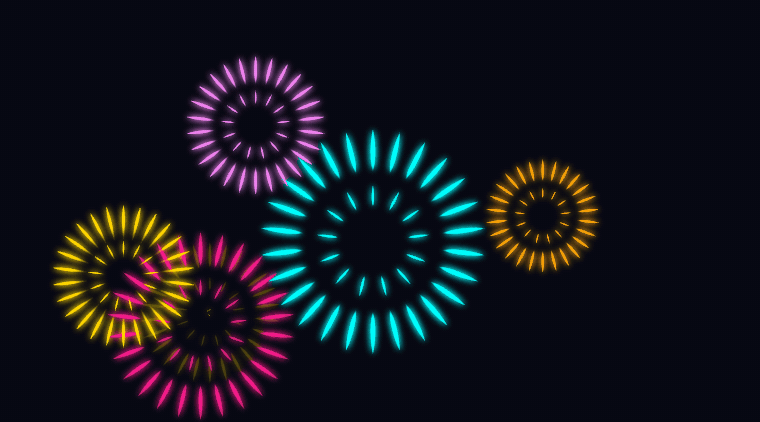</a>

</div>

上の花火は、次の Ruby がそのまま描いたものです。花びらを1枚作り、扇状に並べてひとつの花火にし、6つに増やして空にばらまき、ひとつずつ開かせています。

```rb
require "asobi"

spark = petal(15, 1.8).move(up: 28)
burst = spark.repeat(26).in_fan + spark.repeat(13).in_fan.scale(0.5)
colors = %i[gold deeppink cyan orange violet]
sky = burst.repeat(6).change_each { |b, t, i| b.scale(0.75 + i % 3 * 0.3) }
           .scattered(over: [290, 130], seed: 5).colored(*colors)
bloom = sky.animate(3) { |b, t| b.scale(0.05 + t**0.35).opacity(1 - t**4) }

show bloom.one_by_one.trail(4).glowing(3), on: "#070812", paper: [360, 200]
```

## asobi で作ったもの

下の作品はどれも、そのまま動く Ruby ファイル1つです。絵を選ぶとコードを読めます。

<table>
<tr>
<td align="center" width="50%"><a href="examples/showcase/tunnel.rb">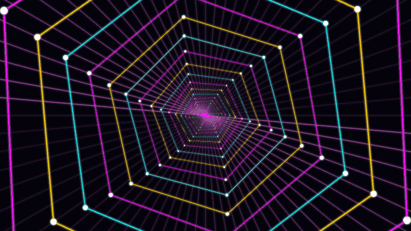</a></td>
<td align="center" width="50%"><a href="examples/showcase/lace.rb">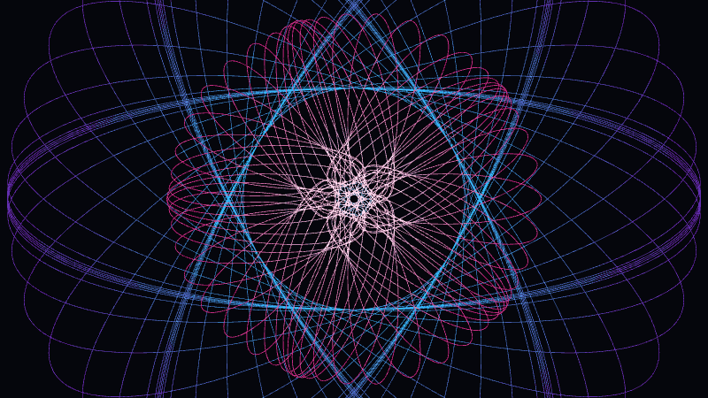</a></td>
</tr>
<tr>
<td align="center"><b><a href="examples/showcase/tunnel.rb">ネオンのトンネル</a></b><br>六角形24枚を <code>one_by_one</code> で次々に飛ばす · 7行</td>
<td align="center"><b><a href="examples/showcase/lace.rb">レース</a></b><br>髪の毛ほど細い楕円132本が波打つ · 6行</td>
</tr>
<tr>
<td align="center" width="50%"><a href="examples/showcase/spectrum.rb">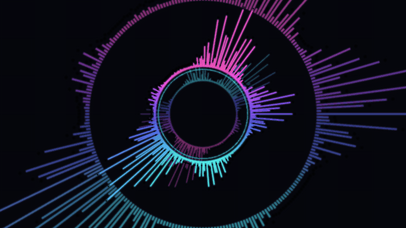</a></td>
<td align="center" width="50%"><a href="examples/showcase/galaxy.rb">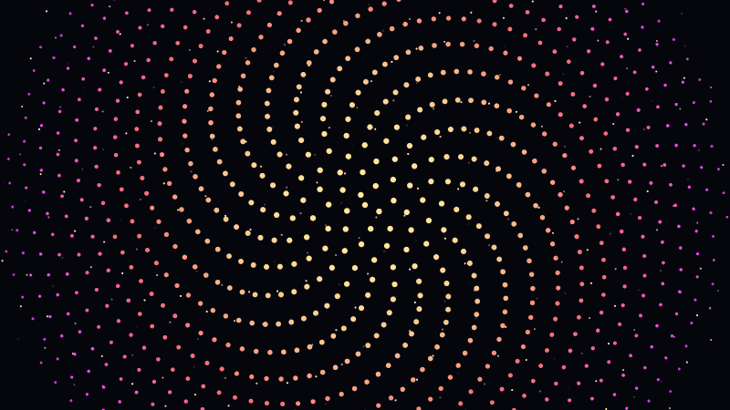</a></td>
</tr>
<tr>
<td align="center"><b><a href="examples/showcase/spectrum.rb">曲のないスペクトラム</a></b><br>240本の棒を <code>in_fan</code> で輪に、1本ずつ別の拍で · 10行</td>
<td align="center"><b><a href="examples/showcase/galaxy.rb">銀河</a></b><br>1,100粒の種を <code>in_spiral</code> に並べ、腕に巻く · 10行</td>
</tr>
<tr>
<td align="center" width="50%"><a href="examples/showcase/poster.rb">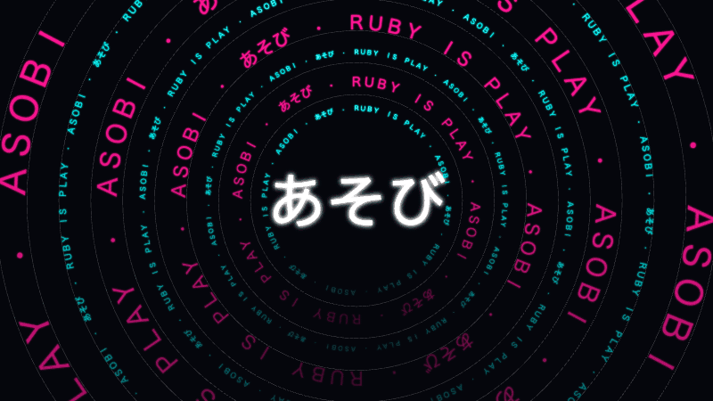</a></td>
<td align="center" width="50%"><a href="examples/showcase/led_wall.rb"></a></td>
</tr>
<tr>
<td align="center"><b><a href="examples/showcase/poster.rb">文字のポスター</a></b><br>840文字を8つの輪に並べ、光の波を走らせる · 14行</td>
<td align="center"><b><a href="examples/showcase/led_wall.rb">LED の壁</a></b><br>2,040個の灯りを少しずつずらして光らせる · 8行</td>
</tr>
<tr>
<td align="center" colspan="2"><a href="examples/reactions/self_portrait.rb">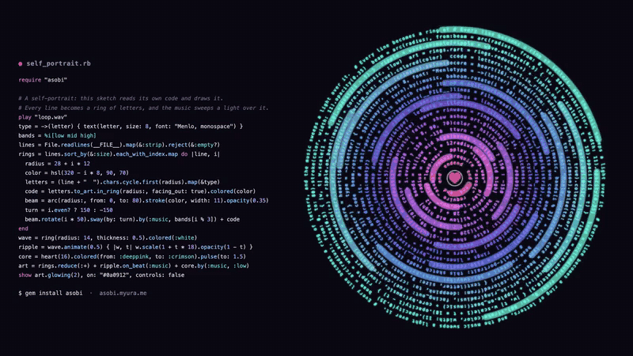</a></td>
</tr>
<tr>
<td align="center" colspan="2"><b><a href="examples/reactions/self_portrait.rb">自画像</a></b><br>自分のコードを読み、1行ずつ文字の輪にして、曲に合わせて光を回す · 18行</td>
</tr>
</table>

## 目次

- [asobi で作ったもの](#asobi-で作ったもの)
- [asobi の考え方](#asobi-の考え方)
- [最初のスケッチを動かす](#最初のスケッチを動かす)
- [asobi を選ぶ理由](#asobi-を選ぶ理由)
- [主な機能](#主な機能)
- [作品ギャラリー](#作品ギャラリー)
- [使える言葉の一覧](#使える言葉の一覧)
- [作品の保存と録画](#作品の保存と録画)
- [既存の Ruby プログラムに組み込む](#既存の-ruby-プログラムに組み込む)
- [よくある質問](#よくある質問) · [ドキュメント](#ドキュメント) · [開発](#開発) · [Issue・PR](#不具合報告改善の提案issuepr)

## asobi の考え方

<table>
<tr>
<td width="50%" valign="top"><b>Object to Art</b><br>数値は円に、文字列はタイポグラフィに、配列や Range は横並びの図形に、自作クラスも <code>to_art</code> で絵になります。一度絵になれば、色も動きも自在につけられます。</td>
<td width="50%" valign="top"><b>Art to Object</b><br>すべての絵は不変の Ruby オブジェクトです。変数に入れ、メソッドに渡し、別の作品へ再利用できます。<code>flower.scale(0.6)</code> は元の花を変えずに新しい花を返し、<code>setup</code> や <code>draw</code> を書く必要はありません。</td>
</tr>
<tr>
<td width="50%" valign="top"><b>英語として読める</b><br><code>petal.repeat(8).in_fan.colored(:crimson, :navy)</code> は「花びらを8回繰り返し、扇状に並べ、深紅と紺で塗る」と左から順に読めます。</td>
<td width="50%" valign="top"><b>外部依存ゼロ・Ruby だけで動く</b><br>外部ソフトは不要です。<code>gem install asobi</code> のあと <code>asobi</code> と打つとブラウザでホットリロードしながら遊べ、同じコードが<a href="https://asobi.myura.me/ja/playground">ブラウザの遊び場</a>でもそのまま動きます。</td>
</tr>
</table>

## 最初のスケッチを動かす

自分のパソコンで動かすには、**Ruby 3.2 以上**とブラウザを用意します。スケッチを置きたいフォルダで次の2行を実行してください。

```sh
gem install asobi
asobi
```

初回は次のコードが入った `play.rb` が作られ、ブラウザで花が回り始めます。すでに同名のファイルがある場合は、そのスケッチが開きます。

<table>
<tr>
<td>

```ruby
require "asobi"

flower = petal.repeat(8).in_fan.colored(:crimson, :navy)
show flower.spin(every: 8)
```

</td>
<td align="center" width="230"></td>
</tr>
</table>

**花びらを増やしてみましょう。** `play.rb` の `repeat(8)` を `repeat(12)` に変えて保存すると、ブラウザの花に4枚の花びらが加わります。`every: 8` を `every: 2` にすると、今度は2秒で1回転します。終了するにはターミナルで Ctrl+C を押します。

<details>
<summary>ほかのスケッチを開く・ポートを指定する</summary>

ほかの作品を開くには、`asobi sketch.rb` のようにファイルを指定します。`require "asobi"` と `show` を書いたスケッチは `ruby sketch.rb` でも開けます。ブラウザを自分で開く場合は `asobi` コマンドに `--no-open` を付けて、ターミナルに表示された URL にアクセスしてください。`--port 5000` を付けると、5000 番から空いているポートを探します（既定は 4567 番）。

</details>

## asobi を選ぶ理由

例として、1枚の絵を取り上げます。回りながら小さくなる 6×6 の正方形のタイルを、2色で描きます。asobi では、これだけで書けます。

```ruby
require "asobi"
tiles = square(18).repeat(36).change_each { |s, t| s.rotate(t * 90).grow(to: 1 - t * 0.5) }
show tiles.in_grid(6, gap: 4).colored(:tomato, :navy)
```

同じ絵を p5.js で省略せずに書くと、次のようになります。

```javascript
function setup() {
  createCanvas(400, 400);
  angleMode(DEGREES);
  rectMode(CENTER);
  noStroke();
  noLoop();
}

function draw() {
  background(255);
  translate(width / 2, height / 2);
  const n = 6, size = 18, step = size + 4;
  const origin = ((n - 1) * step) / 2;
  for (let i = 0; i < 36; i++) {
    const t = i / 36;
    push();
    translate((i % n) * step - origin, Math.floor(i / n) * step - origin);
    rotate(t * 90);
    fill(i % 2 === 0 ? "tomato" : "navy");
    square(0, 0, size * (1 - t * 0.5));
    pop();
  }
}
```

asobi では、`in_grid` が並べ方を、`change_each` が少しずつの変化を、`colored(:tomato, :navy)` が2色の交互の塗り分けを受け持ちます。[遊び場で asobi 版を開き](https://asobi.myura.me/ja/playground#code=cmVxdWlyZSAiYXNvYmkiCnRpbGVzID0gc3F1YXJlKDE4KS5yZXBlYXQoMzYpLmNoYW5nZV9lYWNoIHsgfHMsIHR8IHMucm90YXRlKHQgKiA5MCkuZ3Jvdyh0bzogMSAtIHQgKiAwLjUpIH0Kc2hvdyB0aWxlcy5pbl9ncmlkKDYsIGdhcDogNCkuY29sb3JlZCg6dG9tYXRvLCA6bmF2eSkK)、数字を書き換えて何が動くか試してみてください。

## 主な機能

この節の例を試すときは、`play.rb` の先頭にある `require "asobi"` を残し、その下を例のコードに置き換えてください。

### 図形を重ねる、並べる

`petal(40, 16)` は長さ40、幅16の花びらです。`in_fan` で根元を中心に放射状に並べ、`+` で金色の円を手前に重ねます。`scale(0.6)` は元の60%の大きさの花を返します。`beside` で元の花と並べると、大きな花と小さな花がひとつの絵になります。

<table>
<tr>
<td>

```ruby
petals = petal(40, 16).repeat(8).in_fan.colored(:crimson, :navy)
flower = petals + circle(5).colored(:gold)
show flower.beside(flower.scale(0.6), gap: 12)
```

</td>
<td align="center" width="270">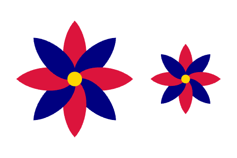</td>
</tr>
</table>

長さは絵の中での大きさを表します。表示するときは絵全体が画面に収まるように拡大・縮小されます。回転角は度で指定し、`rotate(90)` なら時計回りに4分の1回転します。

### Object to Art：Ruby の値が絵になる

`to_art` は Ruby のあらゆる値を絵に変換します。数値は円、文字列やシンボルはタイポグラフィ、配列や Range は要素順の横並び、ハッシュはキーと値を横に並べた表として表現されます。`as:` を渡すと各項を指定した図形の大きさにでき、この例ではフィボナッチ数列が成長する星の列になります。絵になったあとは、ほかの絵と同じように色を塗り、動かせます。

<table>
<tr>
<td>

```ruby
fib = [1, 1, 2, 3, 5, 8, 13, 21]
stars = fib.to_art(as: star).colored(:gold, :orange)
show stars.spin(every: 4).one_by_one, on: :black
```

</td>
<td align="center" width="270"></td>
</tr>
</table>

### Art to Object：自分のクラスが絵になる

自作クラスに絵を返す `to_art` を定義すると、そのままインスタンスを `show` に渡せます。さらに `Asobi::Art` をインクルードすると、インスタンスに対して直接 `spin` や `beside` のような合成・アニメーションメソッドを呼べます。

<table>
<tr>
<td>

```ruby
class Flower
  include Asobi::Art

  def initialize(count, color)
    @count = count
    @color = color
  end

  def to_art
    petal.repeat(@count).in_fan.colored(@color)
  end
end

show Flower.new(7, :coral).spin(every: 4)
```

</td>
<td align="center" width="230"></td>
</tr>
</table>

### 動きは言葉で頼む

動きも `spin`、`pulse`、`sway`、`orbit` のような言葉で付けます。この例では、輪に並べた点を `pulse` で2倍まで膨らませ、元の大きさに戻します。直後に `one_by_one` を付けると、それぞれの点が少しずつ遅れて膨らみ、波が輪を一周します。自分だけの動きは `animate` のブロックに書けます。

<table>
<tr>
<td>

```ruby
dots = circle(5).repeat(24).in_ring.colored(:gold, :orange)
show dots.pulse(every: 2, to: 2).one_by_one, on: :black
```

</td>
<td align="center" width="230">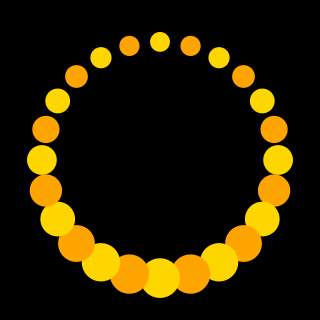</td>
</tr>
</table>

### 光、残像、色の重ね合わせ

効果もメソッドをつなぐだけです。`trail(4)` は少し前の姿を4つ、薄く残します。`glowing` はふちを光らせ、`blended(:screen)` は重なったところを明るくします。`show` に `grain: true` を付けると、絵全体にフィルムのようなざらつきが乗ります。

<table>
<tr>
<td>

```ruby
petals = petal(50, 18).repeat(8).in_fan.colored(:deeppink, :cyan)
glow = petals.spin(every: 4).trail(4).glowing.blended(:screen)
show glow, on: :black, grain: true
```

</td>
<td align="center" width="230">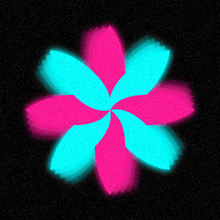</td>
</tr>
</table>

### クリック、マウス、音に反応する

動きのあとに「だれが動かすか」を書くと、時計の代わりに、クリックやマウスや音がその動きを進めます。`when_clicked` はクリックで1回、`while_hovered` はマウスが乗っている間、`when_pressed("a")` はキーを押すと1回動きます。`by` は値に合わせて動きの途中を選びます。`by(:mouse_x)` ならマウスの左右です。

```ruby
dot = circle(8).colored(:deeppink)
dots = dot.pulse(to: 2).when_clicked.repeat(8).in_ring(60)
needle = star(radius: 30).colored(:gold).spin.by(:mouse_x)
show dots + needle, on: :black
```

押した点だけが膨らみ、星はマウスの左右に合わせて回ります。反応を付けた答えも絵なので、並べることも、さらに動かすこともできます。ブラウザの中で Ruby は動いていないので、保存した HTML でも同じように反応します。

音にも反応します。次の例は、マイクが聞いた音で動く VJ 用のスケッチです。

```ruby
burst = star(points: 8, radius: 60, inner: 24).colored(:deeppink)
bass = burst.pulse(to: 1.6).by(:mic, :low).spin(every: 8)
kick = ring(radius: 90, thickness: 3).colored(:cyan).pulse(every: 0.4, to: 1.3).on_beat
show bass.on(kick).glowing, on: :black, controls: false
```

`by(:mic, :low)` は低音の強さで星を膨らませます。`:mid` と `:high` は中音と高音、`:pitch` は音の高さ、何も付けなければ音量です。`on_beat` は拍が聞こえるたびに1回動きます。ブラウザの決まりで、マイクは画面を1回クリックしてから開きます。`controls: false` を付けると録画とコードのボタンが出なくなり、**F** キーで全画面になります。

### 音を鳴らす

`play` は曲のファイルをくり返し流し、`sounding` は反応が始まるたびに音を鳴らします。

```ruby
play "beat.wav"
notes = [:c4, :e4, :g4, :c5]
keys = notes.map { |note| circle(18).colored(:gold).pulse(to: 1.4).when_clicked.sounding(note) }
beat = ring(radius: 90, thickness: 3).colored(:cyan).pulse(every: 0.4, to: 1.2).on_beat(:music)
show keys.to_art.in_row(gap: 16).on(beat), on: :black
```

金色の丸を押すと、ド・ミ・ソ・ドが鳴ります。音階は `:c4` や `"C#4"` のように書き、ほかに `:pop` `:kick` `:snare` `:hat` `:clap` `:bell` の6つの音があります。どれも asobi がブラウザの中で作る音なので、音のファイルは要りません。

`by(:music)` と `on_beat(:music)` は、asobi 自身が鳴らしている音を聞きます。この例の輪は、流している曲の拍で広がります。マイクがなくても、曲に合わせて絵を動かせます。

`beat.wav` は [examples/reactions](examples/reactions/) にある4秒のループです。自分の曲を使うときは、スケッチと同じフォルダに置いて、ファイル名を書き換えてください。スケッチを書き換えて保存しても、同じ曲なら途切れずに流れ続けます。音は画面を1回クリックすると出て、**M** キーで消せます。

### 保存するたびに、絵が変わる

スケッチを実行している間、asobi はファイルを見張っています。エディタで保存すると、ページを読み込み直さなくても絵が差し替わります。アニメーションの時計は止まらないので、動きを見ながら数字を調整できます。

| ライブ表示中の操作 | 結果 |
| --- | --- |
| **C** キーを押す | スケッチのソースコードを、絵の上に字幕のように重ねて表示します。もう一度押すと消えます。 |
| **R** キーを押し、もう一度押す | 録画を開始し、2回目で動画をダウンロードします。対応ブラウザに応じて MP4 または WebM になります。asobi が鳴らした音も入ります。 |
| **F** キーを押す | 全画面に切り替えます。もう一度押すと戻ります。 |
| **M** キーを押す | asobi が鳴らす音を消します。もう一度押すと戻ります。 |
| エラーのあるスケッチを保存する | 直前に描けた絵が残り、その下にエラーメッセージが表示されます。メッセージには、直し方の例も書かれています。 |

## 作品ギャラリー

どの作品も、1つの Ruby ファイルです。画像を選ぶとコードを読めます。リポジトリをクローンして `asobi examples/showcase/phyllotaxis.rb` のように実行すると、手元で動きます。

<table>
<tr>
<td align="center" width="33%"><a href="examples/showcase/phyllotaxis.rb">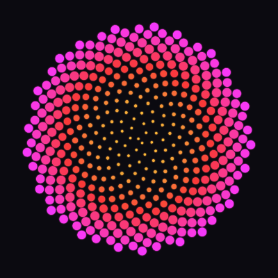</a></td>
<td align="center" width="33%"><a href="examples/showcase/type_rings.rb">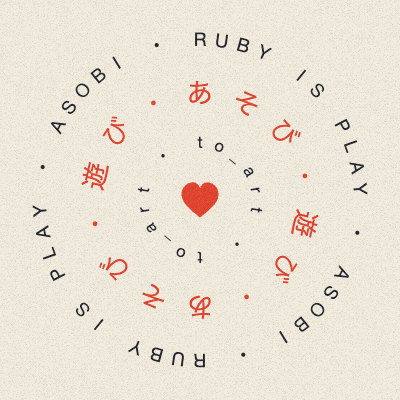</a></td>
<td align="center" width="33%"><a href="examples/showcase/orbits.rb">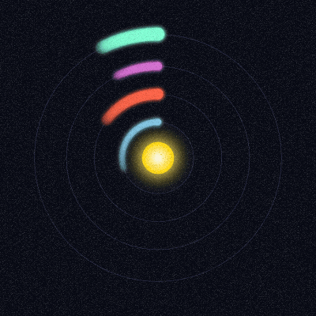</a></td>
</tr>
<tr>
<td align="center"><b><a href="examples/showcase/phyllotaxis.rb">ひまわりの種</a></b><br>400個の円を <code>in_spiral</code> で並べる · 3行</td>
<td align="center"><b><a href="examples/showcase/type_rings.rb">文字の輪</a></b><br>1文字ずつ <code>in_ring</code> に並べて回す · 12行</td>
<td align="center"><b><a href="examples/showcase/orbits.rb">惑星</a></b><br>自作の <code>Planet</code> が <code>to_art</code> で絵になる · 10行</td>
</tr>
</table>

<table>
<tr>
<td align="center" width="33%"><a href="examples/showcase/moire.rb">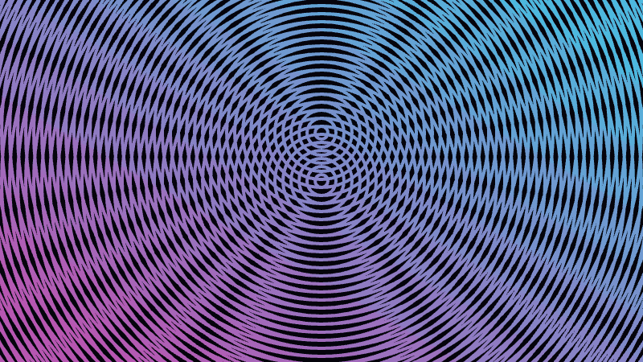</a></td>
<td align="center" width="33%"><a href="examples/showcase/seigaiha.rb">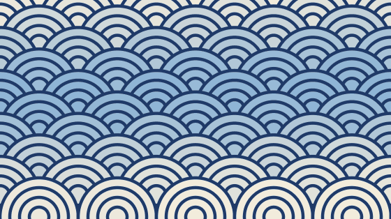</a></td>
<td align="center" width="33%"><a href="examples/showcase/bubble_sort.rb">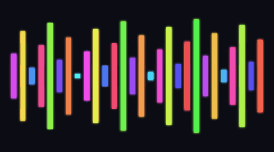</a></td>
</tr>
<tr>
<td align="center"><b><a href="examples/showcase/moire.rb">モアレ</a></b><br>同心円を2組重ね、片方を <code>orbit</code> で回す · 4行</td>
<td align="center"><b><a href="examples/showcase/seigaiha.rb">青海波</a></b><br>輪を半分ずつずらして重ね、<code>shift_color</code> で波を流す · 7行</td>
<td align="center"><b><a href="examples/showcase/bubble_sort.rb">バブルソート</a></b><br>配列の入れ替え1回ごとに <code>to_art</code> で絵にする · 12行</td>
</tr>
</table>

公式サイトの作例は、ブラウザの中でそのまま書き換えられます。画像を選び、「遊び場で開く」を押してください。

| 花 | ハートの窓 | 夜空 |
| :---: | :---: | :---: |
| [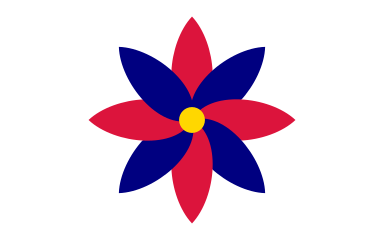](https://asobi.myura.me/ja/examples#flower) | [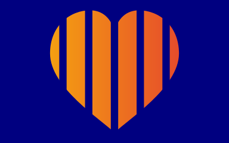](https://asobi.myura.me/ja/examples#through_a_heart) | [](https://asobi.myura.me/ja/examples#night_sky) |
| [`in_fan`](examples/flower.rb) | [`clipped_by`](examples/through_a_heart.rb) | [`fade`](examples/night_sky.rb) |

ほかの作例は [examples フォルダ](examples/README.md)と[サイトの作例ページ](https://asobi.myura.me/ja/examples)にあります。

## 使える言葉の一覧

引数と既定値は[リファレンス](https://asobi.myura.me/ja/reference)で調べられます。数字を省くと、ちょうどよい値が使われます。

| やりたいこと | 言葉 |
| --- | --- |
| **形を作る** | `circle` `ellipse` `rect` `square` `triangle` `polygon` `star` `line` `text` |
| **遊びの形** | `heart` `petal` `moon` `drop` `cloud` |
| **線を描く** | `arc` `wave` `ring` `path` |
| **重ねる・並べる** | `+` `on` `under` `beside` `above` `repeat`（`*`） |
| **配置する** | `in_row` `in_column` `in_grid` `in_ring` `in_fan` `in_spiral` `scattered` `change_each` |
| **形を変える** | `move` `rotate` `scale` `grow` `shrink` `mirror` `flip` |
| **色を付ける** | `colored` `outlined` `stroke` `opacity` `hsl` `gray`、グラデーションは `colored(from: :gold, to: :crimson)` |
| **効果をかける** | `glowing` `blurred` `blended` `shadowed` `clipped_by` `trail`、ざらつきは `show` の `grain: true` |
| **動かす** | `spin` `pulse` `sway` `orbit` `fade` `bounce` `drift` `shift_color` `animate` `one_by_one` |
| **反応させる** | `when_clicked` `while_hovered` `when_pressed` `on_beat`、値に合わせる `by`（`:mouse_x` `:mouse_y` `:mic` `:music`） |
| **音を鳴らす** | `play` で曲、`sounding` で効果音と音階 |
| **値を絵にする** | 数値・配列・範囲・ハッシュ・文字列・シンボルの `to_art`、自作クラスに定義する `to_art` |
| **表示する・保存する** | `show`（`on:` で背景色、`paper:` で用紙の寸法、`controls: false` でボタンなし）、`save` で SVG または HTML、`at` で途中の1コマ |

## 作品の保存と録画

静止画は SVG、アニメーションはブラウザでそのまま再生できる HTML に保存できます。次の例は、スケッチを実行したディレクトリに2つのファイルを書き出し、同じアニメーションをライブ表示します。

```ruby
flower = petal.repeat(8).in_fan.colored(:crimson, :navy)
motion = flower.spin(every: 4)

flower.save("flower.svg")
motion.save("flower.html")
show motion
```

アニメーションの途中を静止画にするには、`motion.at(1).save("frame.svg")` のように秒数を指定します。動画にするには、ライブ表示で **R** キーを押して録画します。

反応する絵は、保存した HTML でも反応します。`play` で流す曲も HTML の中に入るので（20MB まで）、ファイル1つで音ごと渡せます。SVG には、反応する前の止まった絵が入ります。

## 既存の Ruby プログラムに組み込む

`require "asobi"` を使うと、`circle` などをトップレベルで呼べるようになり、数値や配列に `to_art` が加わります。既存のプログラムで Ruby の標準クラスを拡張せずに使うには、`asobi/pure` を読み込みます。次のコードを `export.rb` として保存し、同じフォルダで `ruby export.rb` を実行すると、紺色の星を3つ並べた `stars.svg` ができます。

```ruby
require "asobi/pure"

stars = Asobi.art([3, 1, 4], as: Asobi.star)
stars.colored(:navy).save("stars.svg")
```

## ドキュメント

| 読みたいもの | 場所 |
| --- | --- |
| **Object to Art / Art to Object** を順番に学ぶ | [入門ガイド](https://asobi.myura.me/ja/guide) ([Markdown](https://asobi.myura.me/ja/guide.md)) |
| 図形・配置・動きと既定値を調べる | [リファレンス](https://asobi.myura.me/ja/reference) ([Markdown](https://asobi.myura.me/ja/reference.md)) |
| インストールせずにブラウザで試す | [遊び場](https://asobi.myura.me/ja/playground) |
| 1ファイルで動くスケッチを読む | [作例一覧](examples/README.md) |
| AI エージェントに完全な API コンテキストを渡す | [llms.txt](https://asobi.myura.me/llms.txt) · [llms-full.txt](https://asobi.myura.me/llms-full.txt) · [SKILL.md](https://asobi.myura.me/.well-known/agent-skills/asobi/SKILL.md) |
| 設計の理由を知る | [設計書](DESIGN.md) |
| 変更の履歴を見る | [CHANGELOG](CHANGELOG.md) |

## よくある質問

**Q: asobi とは何ですか？**

asobi（遊び）は、Ruby 3.2 以上だけで動くクリエイティブコーディング用 gem です。SVG の静止画やループアニメーションを生成でき、クリック・マウス・キー・マイク・曲に反応させることもできます。ローカルでのライブコーディングにも、ruby.wasm によるブラウザ上の遊び場にも対応しています。

**Q: 「Object to Art. Art to Object.」とはどういう意味ですか？**

Object to Art は、数値・文字列・配列・ハッシュや `to_art` を定義した自作クラスなど、あらゆる Ruby オブジェクトがそのまま絵になることを表します。Art to Object は、返ってきた絵もキャンバスに消えず不変の Ruby オブジェクト（`Asobi::Art`）として扱えることを意味し、変数への代入、再合成、配列化、アニメーションを状態事故なしに行えます。

**Q: p5.js や Processing、Ruby 2D との違いは何ですか？**

p5.js や Processing は `setup` / `draw` の中でミュータブルなキャンバス状態（`fill`、`translate`、`push`/`pop`）を命令的に更新し、Ruby 2D は SDL ウィンドウ上の可変オブジェクトを書き換えます。asobi はキャンバス状態やネイティブ依存を持たず、すべての図形と動きを英語のように読める不変の Ruby オブジェクトとして組み立てます。

**Q: クリックや音楽、マイクに反応させたり、音を鳴らしたりできますか？**

できます。動きのあとに1語足すと、時計の代わりに何がコマを進めるかを決められます。`when_clicked`、`while_hovered`、`when_pressed("a")`、`on_beat`、そして `by(:mouse_x)`、`by(:mic, :low)`、`by(:music)` です。`play "song.mp3"` は曲をくり返し流し、反応のあとに `sounding(:kick)` や `sounding(:c4)` と書くと、太鼓の音や音階がブラウザの中で作られて鳴ります（音のファイルは不要）。コードを書き換えても曲は途切れないので、ライブコーディングや VJ に向いています。保存した HTML でも反応し、曲も一緒に入ります。

**Q: ImageMagick や SDL、Node.js などの外部ソフトは必要ですか？**

不要です。実行時の依存は Ruby 3.2 以上の標準ライブラリのみです。`gem install asobi` のあと `asobi` と打つだけでブラウザが開き、オンラインの遊び場ならインストールすら不要です。

**Q: 自作のクラスを絵にする方法と、保存できる形式を教えてください。**

クラスに絵を返す `to_art` メソッドを定義するだけです（`include Asobi::Art` を足すとインスタンスに直接 `spin` や `colored` を呼べます）。静止画は `save` で SVG（`art.svg`）に、動きは単体再生できる HTML（`art.html`）に書き出せ、ライブ画面の `r` キーで動画録画も可能です。

## 開発

リポジトリのルートで `ruby exe/asobi examples/flower.rb` を実行すると、ライブラリ本体への変更を試せます。テストの実行とドキュメントの生成には次のコマンドを使います。

```sh
bundle install
bundle exec rake test
bundle exec rake site
```

生成された `_site/ja/index.html` をブラウザで開くと日本語版、`_site/index.html` を開くと英語版を読めます。「遊び場」でコードを編集して実行するには、CDN から ruby.wasm を読み込むためのインターネット接続が必要です。

テストでは、ライブラリと CLI の動作、テスト用データからのサイト生成、ギャラリーと両言語の README に載せたスケッチを検証します。README の GIF は [docs/readme/tools](docs/readme/tools) のスクリプトで作り直せます。

## 不具合報告・改善の提案（Issue・PR）

日本語・英語どちらでも歓迎です。不具合の場合は、問題が起きる短いスケッチがあると再現しやすくなります。機能のアイデアは「こんな絵を描きたい」「こんな動きを作りたい」から気軽にどうぞ。[Issue を作成する](https://github.com/Hayato1031/asobi/issues/new/choose)

バグの修正、ドキュメントの改善、作例の追加などのプルリクエスト（PR）も歓迎です。[asobi をフォーク](https://github.com/Hayato1031/asobi/fork)して、自分のフォークにブランチを作り、変更を `Hayato1031/asobi` の `main` 宛てに送ってください。大きな変更は、先に Issue で相談できます。

## ライセンス

[MIT ライセンス](LICENSE) · [RubyGems](https://rubygems.org/gems/asobi) · [公式サイト](https://asobi.myura.me/ja/) · [llms.txt](https://asobi.myura.me/llms.txt)
