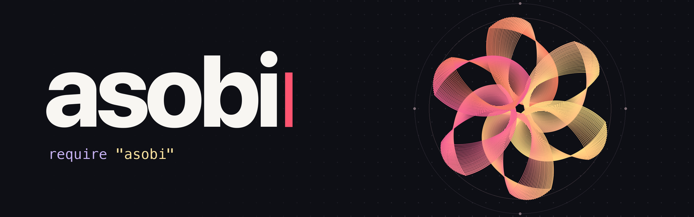
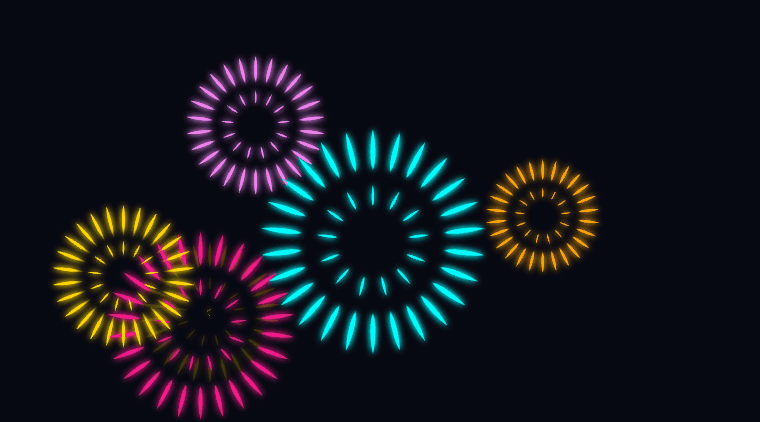
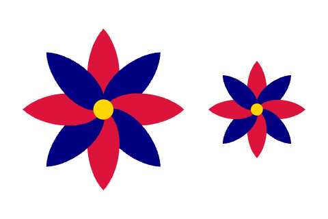
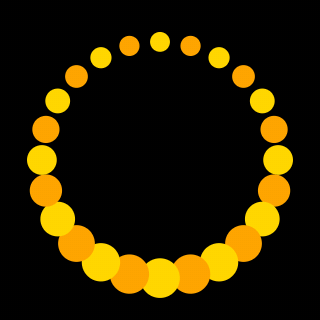
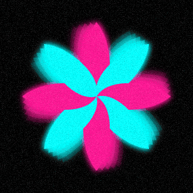
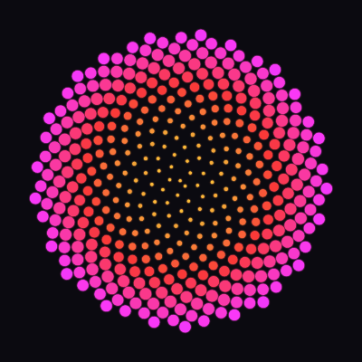
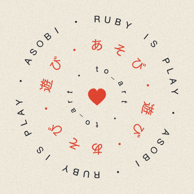
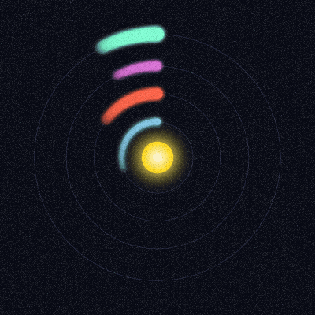
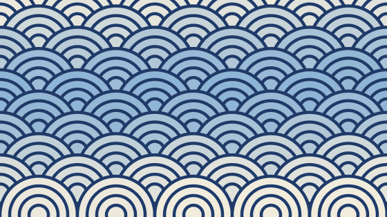
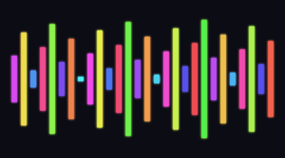

<div align="center">



[English](README.md) · **日本語**

# 絵は、Ruby のオブジェクト。

**asobi（遊び）は、Ruby で図形を組み合わせて、絵とループアニメーションを作る gem です。**<br>
花びらを並べて花を作り、`spin` と書くと花ごと回ります。配列も、自分のクラスも、`to_art` で絵になります。

[](https://rubygems.org/gems/asobi)
[](https://rubygems.org/gems/asobi)
[](https://www.ruby-lang.org/ja/)
[](LICENSE)
[](#不具合報告改善の提案issuepr)

<a href="https://asobi.myura.me/ja/playground.html"></a>
<a href="https://asobi.myura.me/ja/guide.html"></a>
<a href="https://asobi.myura.me/ja/reference.html"></a>
<a href="https://asobi.myura.me/ja/examples.html"></a>
<a href="https://asobi.myura.me/ja/#film"></a>

<br>

<a href="examples/showcase/hanabi.rb"></a>

</div>

上の花火は、次の Ruby がそのまま描いたものです。花びらを1枚作り、扇状に並べてひとつの花火にし、6つに増やして空にばらまき、ひとつずつ開かせています。

```rb
require "asobi"

spark = petal(15, 1.8).move(up: 28)
burst = spark.repeat(26).in_fan + spark.repeat(13).in_fan.scale(0.5)
colors = %i[gold deeppink cyan orange violet]
sky = burst.repeat(6).change_each { |b, t, i| b.scale(0.75 + i % 3 * 0.3) }
           .scattered(over: [290, 130], seed: 5).colored(*colors)
bloom = sky.animate(3) { |b, t| b.scale(0.05 + t**0.35).opacity(1 - t**4) }

show bloom.one_by_one.trail(4, gap: 0.05).glowing(3), on: "#070812", paper: [360, 200]
```

## 目次

- [asobi の考え方](#asobi-の考え方)
- [最初のスケッチを動かす](#最初のスケッチを動かす)
- [主な機能](#主な機能)
- [作品ギャラリー](#作品ギャラリー)
- [使える言葉の一覧](#使える言葉の一覧)
- [作品の保存と録画](#作品の保存と録画)
- [既存の Ruby プログラムに組み込む](#既存の-ruby-プログラムに組み込む)
- [ドキュメント](#ドキュメント) · [開発](#開発) · [Issue・PR](#不具合報告改善の提案issuepr)

## asobi の考え方

<table>
<tr>
<td width="50%" valign="top"><b>絵はオブジェクト</b><br>絵は変数に入れられ、メソッドに渡せて、配列に入れられます。<code>flower.scale(0.6)</code> は元の花を変えずに、小さな花を新しく返します。<code>setup</code> と <code>draw</code> を書く必要はありません。</td>
<td width="50%" valign="top"><b>英語として読める</b><br><code>petal.repeat(8).in_fan.colored(:crimson, :navy)</code> は「花びらを8回繰り返し、扇状に並べ、深紅と紺で塗る」と左から順に読めます。</td>
</tr>
<tr>
<td width="50%" valign="top"><b>すぐ遊べる</b><br><code>gem install asobi</code> のあと <code>asobi</code> と打つだけで、ブラウザに花が回ります。数字を省いても、ちょうどよい大きさで描かれます。ファイルを保存するたびに、絵が差し替わります。</td>
<td width="50%" valign="top"><b>Ruby だけで動く</b><br>外部のソフトを必要としません。同じコードが<a href="https://asobi.myura.me/ja/playground.html">ブラウザの遊び場</a>でも動くので、インストールせずに試せます。</td>
</tr>
</table>

## 最初のスケッチを動かす

自分のパソコンで動かすには、**Ruby 3.2 以上**とブラウザを用意します。スケッチを置きたいフォルダで次の2行を実行してください。

```sh
gem install asobi
asobi
```

初回は次のコードが入った `play.rb` が作られ、ブラウザで花が回り始めます。すでに同名のファイルがある場合は、そのスケッチが開きます。

<table>
<tr>
<td>

```ruby
require "asobi"

flower = petal.repeat(8).in_fan.colored(:crimson, :navy)
show flower.spin(every: 8)
```

</td>
<td align="center" width="230"></td>
</tr>
</table>

**花びらを増やしてみましょう。** `play.rb` の `repeat(8)` を `repeat(12)` に変えて保存すると、ブラウザの花に4枚の花びらが加わります。`every: 8` を `every: 2` にすると、今度は2秒で1回転します。終了するにはターミナルで Ctrl+C を押します。

<details>
<summary>ほかのスケッチを開く・ポートを指定する</summary>

ほかの作品を開くには、`asobi sketch.rb` のようにファイルを指定します。`require "asobi"` と `show` を書いたスケッチは `ruby sketch.rb` でも開けます。ブラウザを自分で開く場合は `asobi` コマンドに `--no-open` を付けて、ターミナルに表示された URL にアクセスしてください。`--port 5000` を付けると、5000 番から空いているポートを探します（既定は 4567 番）。

</details>

## 主な機能

この節の例を試すときは、`play.rb` の先頭にある `require "asobi"` を残し、その下を例のコードに置き換えてください。

### 図形を重ねる、並べる

`petal(40, 16)` は長さ40、幅16の花びらです。`in_fan` で根元を中心に放射状に並べ、`+` で金色の円を手前に重ねます。`scale(0.6)` は元の60%の大きさの花を返します。`beside` で元の花と並べると、大きな花と小さな花がひとつの絵になります。

<table>
<tr>
<td>

```ruby
petals = petal(40, 16).repeat(8).in_fan.colored(:crimson, :navy)
flower = petals + circle(5).colored(:gold)
show flower.beside(flower.scale(0.6), gap: 12)
```

</td>
<td align="center" width="270"></td>
</tr>
</table>

長さは絵の中での大きさを表します。表示するときは絵全体が画面に収まるように拡大・縮小されます。回転角は度で指定し、`rotate(90)` なら時計回りに4分の1回転します。

### Ruby の値が絵になる

`to_art` は Ruby の値を絵に変換します。この例ではフィボナッチ数列の各項が星の大きさになり、小さな星から順に横一列に並びます。`as:` を省くと、各項を半径とする円になります。絵になったあとは、ほかの絵と同じように色を塗り、動かせます。

<table>
<tr>
<td>

```ruby
fib = [1, 1, 2, 3, 5, 8, 13, 21]
stars = fib.to_art(as: star).colored(:gold, :orange)
show stars.spin(every: 4).one_by_one, on: :black
```

</td>
<td align="center" width="270"></td>
</tr>
</table>

### 自分のクラスが絵になる

自作クラスに絵を返す `to_art` を定義すると、そのインスタンスを `show` に渡せます。さらに `Asobi::Art` をインクルードすると、インスタンスに対して直接 `spin` や `beside` を呼べます。

<table>
<tr>
<td>

```ruby
class Flower
  include Asobi::Art

  def initialize(count, color)
    @count = count
    @color = color
  end

  def to_art
    petal.repeat(@count).in_fan.colored(@color)
  end
end

show Flower.new(7, :coral).spin(every: 4)
```

</td>
<td align="center" width="230"></td>
</tr>
</table>

### 動きは言葉で頼む

動きも `spin`、`pulse`、`sway`、`orbit` のような言葉で付けます。この例では、輪に並べた点を `pulse` で2倍まで膨らませ、元の大きさに戻します。直後に `one_by_one` を付けると、それぞれの点が少しずつ遅れて膨らみ、波が輪を一周します。自分だけの動きは `animate` のブロックに書けます。

<table>
<tr>
<td>

```ruby
dots = circle(5).repeat(24).in_ring.colored(:gold, :orange)
show dots.pulse(every: 2, to: 2).one_by_one, on: :black
```

</td>
<td align="center" width="230"></td>
</tr>
</table>

### 光、残像、色の重ね合わせ

効果もメソッドをつなぐだけです。`trail(4)` は少し前の姿を4つ、薄く残します。`glowing` はふちを光らせ、`blended(:screen)` は重なったところを明るくします。`show` に `grain: true` を付けると、絵全体にフィルムのようなざらつきが乗ります。

<table>
<tr>
<td>

```ruby
petals = petal(50, 18).repeat(8).in_fan.colored(:deeppink, :cyan)
glow = petals.spin(every: 4).trail(4).glowing.blended(:screen)
show glow, on: :black, grain: true
```

</td>
<td align="center" width="230"></td>
</tr>
</table>

### 保存するたびに、絵が変わる

スケッチを実行している間、asobi はファイルを見張っています。エディタで保存すると、ページを読み込み直さなくても絵が差し替わります。アニメーションの時計は止まらないので、動きを見ながら数字を調整できます。

| ライブ表示中の操作 | 結果 |
| --- | --- |
| **C** キーを押す | スケッチのソースコードを、絵の上に字幕のように重ねて表示します。もう一度押すと消えます。 |
| **R** キーを押し、もう一度押す | 録画を開始し、2回目で動画をダウンロードします。対応ブラウザに応じて MP4 または WebM になります。 |
| エラーのあるスケッチを保存する | 直前に描けた絵が残り、その下にエラーメッセージが表示されます。メッセージには、直し方の例も書かれています。 |

## 作品ギャラリー

どの作品も、1つの Ruby ファイルです。画像を選ぶとコードを読めます。リポジトリをクローンして `asobi examples/showcase/phyllotaxis.rb` のように実行すると、手元で動きます。

<table>
<tr>
<td align="center" width="33%"><a href="examples/showcase/phyllotaxis.rb"></a></td>
<td align="center" width="33%"><a href="examples/showcase/type_rings.rb"></a></td>
<td align="center" width="33%"><a href="examples/showcase/orbits.rb"></a></td>
</tr>
<tr>
<td align="center"><b><a href="examples/showcase/phyllotaxis.rb">ひまわりの種</a></b><br>400個の円を <code>in_spiral</code> で並べる · 3行</td>
<td align="center"><b><a href="examples/showcase/type_rings.rb">文字の輪</a></b><br>1文字ずつ <code>in_ring</code> に並べて回す · 12行</td>
<td align="center"><b><a href="examples/showcase/orbits.rb">惑星</a></b><br>自作の <code>Planet</code> が <code>to_art</code> で絵になる · 10行</td>
</tr>
</table>

<table>
<tr>
<td align="center" width="50%"><a href="examples/showcase/seigaiha.rb"></a></td>
<td align="center" width="50%"><a href="examples/showcase/bubble_sort.rb"></a></td>
</tr>
<tr>
<td align="center"><b><a href="examples/showcase/seigaiha.rb">青海波</a></b><br>輪を半分ずつずらして重ね、<code>shift_color</code> で波を流す · 7行</td>
<td align="center"><b><a href="examples/showcase/bubble_sort.rb">バブルソート</a></b><br>配列の入れ替え1回ごとに <code>to_art</code> で絵にする · 12行</td>
</tr>
</table>

公式サイトの作例は、ブラウザの中でそのまま書き換えられます。画像を選び、「遊び場で開く」を押してください。

| 花 | ハートの窓 | 夜空 |
| :---: | :---: | :---: |
| [](https://asobi.myura.me/ja/examples.html#flower) | [](https://asobi.myura.me/ja/examples.html#through_a_heart) | [](https://asobi.myura.me/ja/examples.html#night_sky) |
| [`in_fan`](examples/flower.rb) | [`clipped_by`](examples/through_a_heart.rb) | [`fade`](examples/night_sky.rb) |

ほかの作例は [examples フォルダ](examples/README.md)と[サイトの作例ページ](https://asobi.myura.me/ja/examples.html)にあります。

## 使える言葉の一覧

引数と既定値は[リファレンス](https://asobi.myura.me/ja/reference.html)で調べられます。数字を省くと、ちょうどよい値が使われます。

| やりたいこと | 言葉 |
| --- | --- |
| **形を作る** | `circle` `ellipse` `rect` `square` `triangle` `polygon` `star` `line` `text` |
| **遊びの形** | `heart` `petal` `moon` `drop` `cloud` |
| **線を描く** | `arc` `wave` `ring` `path` |
| **重ねる・並べる** | `+` `on` `under` `beside` `above` `repeat`（`*`） |
| **配置する** | `in_row` `in_column` `in_grid` `in_ring` `in_fan` `in_spiral` `scattered` `change_each` |
| **形を変える** | `move` `rotate` `scale` `grow` `shrink` `mirror` `flip` |
| **色を付ける** | `colored` `outlined` `stroke` `opacity` `hsl` `gray`、グラデーションは `colored(from: :gold, to: :crimson)` |
| **効果をかける** | `glowing` `blurred` `blended` `shadowed` `clipped_by` `trail`、ざらつきは `show` の `grain: true` |
| **動かす** | `spin` `pulse` `sway` `orbit` `fade` `bounce` `drift` `shift_color` `animate` `one_by_one` |
| **値を絵にする** | 数値・配列・範囲・ハッシュ・文字列・シンボルの `to_art`、自作クラスに定義する `to_art` |
| **表示する・保存する** | `show`（`on:` で背景色、`paper:` で用紙の寸法）、`save` で SVG または HTML、`at` で途中の1コマ |

## 作品の保存と録画

静止画は SVG、アニメーションはブラウザでそのまま再生できる HTML に保存できます。次の例は、スケッチを実行したディレクトリに2つのファイルを書き出し、同じアニメーションをライブ表示します。

```ruby
flower = petal.repeat(8).in_fan.colored(:crimson, :navy)
motion = flower.spin(every: 4)

flower.save("flower.svg")
motion.save("flower.html")
show motion
```

アニメーションの途中を静止画にするには、`motion.at(1).save("frame.svg")` のように秒数を指定します。動画にするには、ライブ表示で **R** キーを押して録画します。

## 既存の Ruby プログラムに組み込む

`require "asobi"` を使うと、`circle` などをトップレベルで呼べるようになり、数値や配列に `to_art` が加わります。既存のプログラムで Ruby の標準クラスを拡張せずに使うには、`asobi/pure` を読み込みます。次のコードを `export.rb` として保存し、同じフォルダで `ruby export.rb` を実行すると、紺色の星を3つ並べた `stars.svg` ができます。

```ruby
require "asobi/pure"

stars = Asobi.art([3, 1, 4], as: Asobi.star)
stars.colored(:navy).save("stars.svg")
```

## ドキュメント

| 読みたいもの | 場所 |
| --- | --- |
| 絵を作る手順を順番に学ぶ | [入門ガイド](https://asobi.myura.me/ja/guide.html) |
| メソッドの引数や既定値を調べる | [リファレンス](https://asobi.myura.me/ja/reference.html) |
| インストールせずに試す | [遊び場](https://asobi.myura.me/ja/playground.html) |
| 1ファイルで動くスケッチを読む | [作例一覧](examples/README.md) |
| 設計の理由を知る | [設計書](DESIGN.md) |
| 変更の履歴を見る | [CHANGELOG](CHANGELOG.md) |

## 開発

リポジトリのルートで `ruby exe/asobi examples/flower.rb` を実行すると、ライブラリ本体への変更を試せます。テストの実行とドキュメントの生成には次のコマンドを使います。

```sh
bundle install
bundle exec rake test
bundle exec rake site
```

生成された `_site/ja/index.html` をブラウザで開くと日本語版、`_site/index.html` を開くと英語版を読めます。「遊び場」でコードを編集して実行するには、CDN から ruby.wasm を読み込むためのインターネット接続が必要です。

テストでは、ライブラリと CLI の動作、テスト用データからのサイト生成、ギャラリーと両言語の README に載せたスケッチを検証します。README の GIF は [docs/readme/tools](docs/readme/tools) のスクリプトで作り直せます。

## 不具合報告・改善の提案（Issue・PR）

日本語・英語どちらでも歓迎です。不具合の場合は、問題が起きる短いスケッチがあると再現しやすくなります。機能のアイデアは「こんな絵を描きたい」「こんな動きを作りたい」から気軽にどうぞ。[Issue を作成する](https://github.com/Hayato1031/asobi/issues/new/choose)

バグの修正、ドキュメントの改善、作例の追加などのプルリクエスト（PR）も歓迎です。[asobi をフォーク](https://github.com/Hayato1031/asobi/fork)して、自分のフォークにブランチを作り、変更を `Hayato1031/asobi` の `main` 宛てに送ってください。大きな変更は、先に Issue で相談できます。

## ライセンス

[MIT ライセンス](LICENSE) · [RubyGems](https://rubygems.org/gems/asobi) · [公式サイト](https://asobi.myura.me/ja/)
