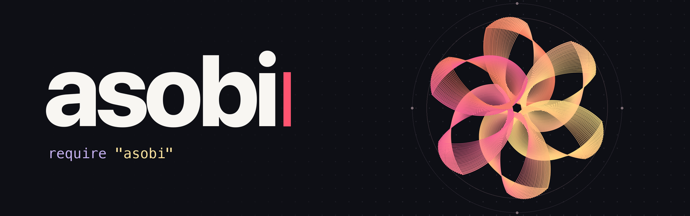

# 

**English** · [日本語](README.ja.md)

**Make SVG pictures and looping animations with Ruby.** In asobi (Japanese for “play”), a picture is a Ruby object. Copy a petal eight times, arrange the petals into a flower, then call `spin` on the whole flower.

**[Try it in your browser](https://asobi.myura.me/playground.html)** · [Read the guide](https://asobi.myura.me/guide.html) · [Watch the 32-second film](https://asobi.myura.me/#film)

## Sketch gallery

Select an animation, then **Open in playground** to edit the sketch. The method names below the previews link to the Ruby source.

| Flower | Through a heart | Night sky |
| :---: | :---: | :---: |
| [](https://asobi.myura.me/examples.html#flower) | [](https://asobi.myura.me/examples.html#through_a_heart) | [](https://asobi.myura.me/examples.html#night_sky) |
| [`in_fan`](examples/flower.rb) | [`clipped_by`](examples/through_a_heart.rb) | [`fade`](examples/night_sky.rb) |

## Run your first sketch

For a local sketch, you'll need **Ruby 3.2 or newer** and a browser. Run these commands in the folder where you'd like to keep your sketch.

```sh
gem install asobi
asobi
```

asobi creates `play.rb` with the sketch below and opens the spinning flower in your browser. If `play.rb` already exists, it opens that sketch.

```ruby
require "asobi"

flower = petal.repeat(8).in_fan.colored(:crimson, :navy)
show flower.spin(every: 8)
```

**Try a change.** In `play.rb`, change `repeat(8)` to `repeat(12)` and save. Four more petals appear in the browser. Change `every: 8` to `every: 2` and the flower completes a turn in two seconds. Press Ctrl-C in the terminal to stop the preview.

<details>
<summary>Open another sketch or choose a port</summary>

To open another sketch, pass its path to `asobi`, for example `asobi sketch.rb`. A file that contains `require "asobi"` and calls `show` also runs with `ruby sketch.rb`. Add `--no-open` to the `asobi` command to open the URL printed in the terminal yourself. The server looks for a free port starting at 4567. Use `--port 5000` to start the search at 5000.

</details>

## Build pictures in Ruby

To try each example in this section, keep `require "asobi"` at the top of `play.rb` and replace the lines beneath it.

### Arrange and combine shapes

`repeat` makes copies in the same spot. `in_fan` turns them around a shared centre. With `a + b`, the second picture sits on top, so a small circle added last becomes the centre of the flower.

```ruby
petals = petal(40, 16).repeat(8).in_fan.colored(:crimson, :navy)
flower = petals + circle(5).colored(:gold)
show flower.beside(flower.scale(0.6), gap: 12)
```

The smaller flower is a new picture. The original keeps its size. Lengths are relative to the other shapes in the sketch, and the preview fits the drawing to the screen. Angles are measured in degrees clockwise, so `rotate(90)` makes a quarter turn.

### Turn data into a picture

With `to_art`, a number becomes a disc, and an array becomes a row of pictures in element order. Give it a shape with `as:` to use each number as the size of that shape. Here the Fibonacci sequence becomes a row of growing stars.

```ruby
fib = [1, 1, 2, 3, 5, 8, 13, 21]
show fib.to_art(as: star).colored(:gold, :orange), on: :black
```

### Give your own class a visual form

Define `to_art` to return the picture for an instance. Include `Asobi::Art` when you also want to call methods such as `spin` on the instance itself.

```ruby
class Flower
  include Asobi::Art

  def initialize(count, color)
    @count = count
    @color = color
  end

  def to_art
    petal.repeat(@count).in_fan.colored(@color)
  end
end

show Flower.new(7, :coral).spin(every: 4)
```

### Animate a group

The dots below grow to twice their size and shrink back over two seconds. Placing `one_by_one` after `pulse` offsets the start of each dot's motion, sending a pulse around the ring.

```ruby
dots = circle(5).repeat(24).in_ring.colored(:gold, :orange)
show dots.pulse(every: 2, to: 2).one_by_one, on: :black
```

<details>
<summary>More shapes, colours and ways to move them</summary>

| To do this | Try |
| --- | --- |
| Start with a shape | `circle`, `rect`, `star`, `text`, `path`, `wave`, `heart`, `petal` |
| Arrange copies | `in_row` for a line, `in_grid` for tiles, `in_ring` for a circle, `in_spiral` for a spiral |
| Add colour and texture | `colored(from: :gold, to: :crimson)` for a gradient, `glowing` for a halo, `shadowed` for a shadow, `clipped_by` for a cut-out |
| Add motion | `spin` to rotate, `sway` to rock, `orbit` to circle a point, `trail` for fading copies, `animate` for your own motion |
| Set up the preview | In `show`, use `on:` for the background colour, `paper:` for page dimensions, or `grain: true` for film grain |

</details>

## Preview, export and record

Use `save` to write a still picture as SVG or a playable animation as a self-contained HTML file. You can open the HTML file directly in a browser. The example writes both files to the current directory.

```ruby
flower = petal.repeat(8).in_fan.colored(:crimson, :navy)
motion = flower.spin(every: 4)

flower.save("flower.svg")
motion.save("flower.html")
show motion
```

To save a particular frame, use `motion.at(1).save("frame.svg")` for the picture one second into the loop.

| In the live preview | What happens |
| --- | --- |
| Press **C** | Toggle the sketch's source code. |
| Press **R**, then **R** again | Start recording, then download the clip as MP4 or WebM in a supported browser. |
| Save a sketch with an error | The last picture stays visible, with the error message underneath. |

## Use asobi from an existing Ruby program

Load `asobi/pure` to keep shape names under `Asobi` and leave Ruby's built-in classes untouched. Save the following as `export.rb` and run `ruby export.rb` from the same folder. It writes three navy stars to `stars.svg`.

```ruby
require "asobi/pure"

stars = Asobi.art([3, 1, 4], as: Asobi.star)
stars.colored(:navy).save("stars.svg")
```

## Examples and reference

Follow a sketch step by step in the [guide](https://asobi.myura.me/guide.html), or look up arguments and defaults in the [method reference](https://asobi.myura.me/reference.html).

Each file is a complete sketch. From a checkout of the repository, try `asobi examples/flower.rb`. [Browse all examples](examples/README.md)

- Turn a number sequence into a row of stars. [Number sequence](examples/sequence.rb)
- Layer glow, screen blending and trails. [Neon flower](examples/neon_flower.rb)
- Give a custom class an orbit and compose several instances into one picture. [Planets](examples/planets.rb)

## Development

From the repository root, use `ruby exe/asobi examples/flower.rb` to try changes to the library. Run the following commands to test the library and build the documentation site locally.

```sh
bundle install
bundle exec rake test
bundle exec rake site
```

Open `_site/index.html` in a browser for English or `_site/ja/index.html` for Japanese. Editing and running code in the playground requires an internet connection to load its Ruby WebAssembly runtime from a CDN.

The suite checks the library and CLI, builds the site with test data, and runs the sketches from the gallery and both READMEs. For the design of pictures, motion and the `to_art` protocol, see the [design notes (Japanese)](DESIGN.md).

## Issues and pull requests

Issues are welcome in English or Japanese. For a bug, a small sketch that shows the problem helps us reproduce it. For an idea, tell us what you'd like to draw or animate. [Open an issue](https://github.com/Hayato1031/asobi/issues/new/choose)

Want to fix a bug, improve the docs, or share a sketch? [Fork asobi](https://github.com/Hayato1031/asobi/fork), make your change on a branch in your fork, and open a pull request against `Hayato1031/asobi:main`. English and Japanese are both welcome. For a larger change, an issue is a good place to discuss the idea first.

## License

[MIT](LICENSE) · [RubyGems](https://rubygems.org/gems/asobi) · [Official website](https://asobi.myura.me/)
