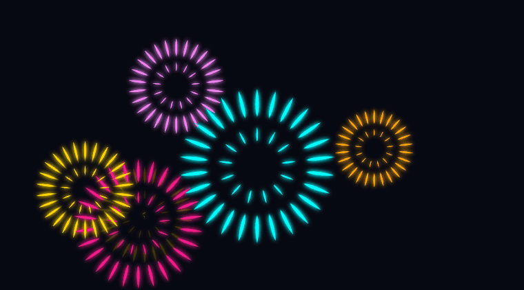
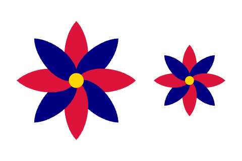
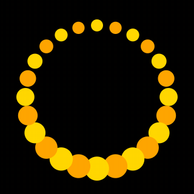
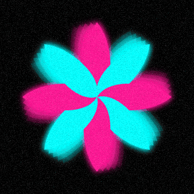
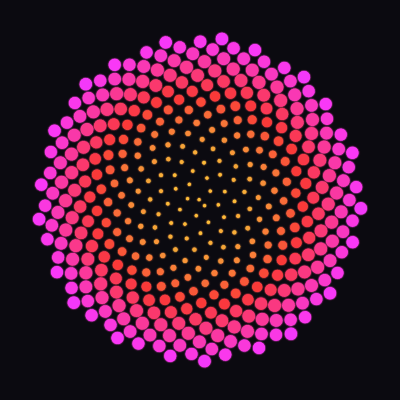
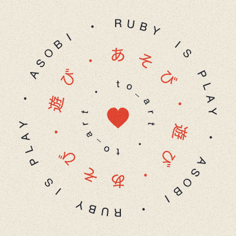
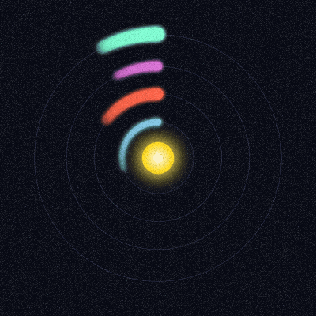
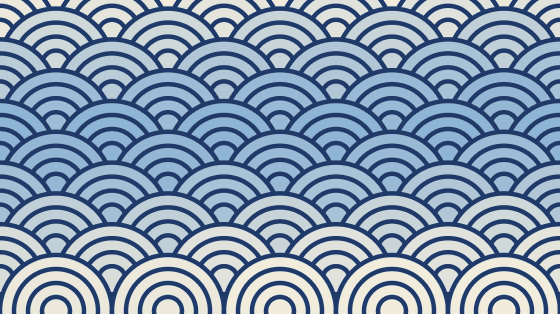
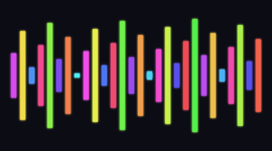

<div align="center">


**English** · [日本語](README.ja.md)

# Object to Art. Art to Object.

**asobi (Japanese for “play”) is a zero-dependency creative coding gem for making geometric pictures and looping animations in Ruby.**<br>
Turn Ruby values and your own classes into pictures with `to_art` — **Object to Art**. Keep, compose, and animate every picture as an immutable Ruby object — **Art to Object**.

[](https://rubygems.org/gems/asobi)
[](https://rubygems.org/gems/asobi)
[](https://www.ruby-lang.org/)
[](LICENSE)
[](#issues-and-pull-requests)

<a href="https://asobi.myura.me/playground.html"></a>
<a href="https://asobi.myura.me/guide.html"></a>
<a href="https://asobi.myura.me/reference.html"></a>
<a href="https://asobi.myura.me/examples.html"></a>
<a href="https://asobi.myura.me/#film"></a>

<br>

<a href="examples/showcase/hanabi.rb"></a>

</div>

The fireworks above are drawn by the Ruby below, exactly as written. It makes one spark, fans copies of it into a burst, scatters six bursts across the sky, and opens them one by one.

```rb
require "asobi"

spark = petal(15, 1.8).move(up: 28)
burst = spark.repeat(26).in_fan + spark.repeat(13).in_fan.scale(0.5)
colors = %i[gold deeppink cyan orange violet]
sky = burst.repeat(6).change_each { |b, t, i| b.scale(0.75 + i % 3 * 0.3) }
           .scattered(over: [290, 130], seed: 5).colored(*colors)
bloom = sky.animate(3) { |b, t| b.scale(0.05 + t**0.35).opacity(1 - t**4) }

show bloom.one_by_one.trail(4, gap: 0.05).glowing(3), on: "#070812", paper: [360, 200]
```

## Contents

- [How asobi thinks](#how-asobi-thinks)
- [Run your first sketch](#run-your-first-sketch)
- [Key features](#key-features)
- [Sketch gallery](#sketch-gallery)
- [Every word at a glance](#every-word-at-a-glance)
- [Export and record](#export-and-record)
- [Use asobi from an existing Ruby program](#use-asobi-from-an-existing-ruby-program)
- [Documentation](#documentation) · [Development](#development) · [Issues and pull requests](#issues-and-pull-requests)

## How asobi thinks

<table>
<tr>
<td width="50%" valign="top"><b>Object to Art</b><br>Numbers become discs, strings become type, arrays and ranges become visual rows, and your own classes gain visual form through <code>to_art</code>. Once converted, they behave like any other picture.</td>
<td width="50%" valign="top"><b>Art to Object</b><br>Every picture is an immutable Ruby object. Hold it in a variable, pass it to a method, or reuse it across a composition — <code>flower.scale(0.6)</code> returns a new flower and leaves the original unchanged, with no <code>setup</code> or <code>draw</code> loop to wire up.</td>
</tr>
<tr>
<td width="50%" valign="top"><b>Reads like English</b><br><code>petal.repeat(8).in_fan.colored(:crimson, :navy)</code> reads from left to right: repeat a petal eight times, fan the copies out, colour them crimson and navy.</td>
<td width="50%" valign="top"><b>Nothing but Ruby</b><br>Zero external dependencies. Run <code>gem install asobi</code> and <code>asobi</code> to live-code in your browser with automatic reload, or run sketches straight in the <a href="https://asobi.myura.me/playground.html">browser playground</a>.</td>
</tr>
</table>

## Run your first sketch

For a local sketch, you'll need **Ruby 3.2 or newer** and a browser. Run these commands in the folder where you'd like to keep your sketch.

```sh
gem install asobi
asobi
```

asobi creates `play.rb` with the sketch below and opens the spinning flower in your browser. If `play.rb` already exists, it opens that sketch.

<table>
<tr>
<td>

```ruby
require "asobi"

flower = petal.repeat(8).in_fan.colored(:crimson, :navy)
show flower.spin(every: 8)
```

</td>
<td align="center" width="230"></td>
</tr>
</table>

**Try a change.** In `play.rb`, change `repeat(8)` to `repeat(12)` and save. Four more petals appear in the browser. Change `every: 8` to `every: 2` and the flower completes a turn in two seconds. Press Ctrl-C in the terminal to stop the preview.

<details>
<summary>Open another sketch or choose a port</summary>

To open another sketch, pass its path to `asobi`, for example `asobi sketch.rb`. A file that contains `require "asobi"` and calls `show` also runs with `ruby sketch.rb`. Add `--no-open` to the `asobi` command to open the URL printed in the terminal yourself. The server looks for a free port starting at 4567. Use `--port 5000` to start the search at 5000.

</details>

## Key features

To try each example in this section, keep `require "asobi"` at the top of `play.rb` and replace the lines beneath it.

### Arrange and combine shapes

`repeat` makes copies in the same spot. `in_fan` turns them around a shared centre. With `a + b`, the second picture sits on top, so a small circle added last becomes the centre of the flower. `scale(0.6)` returns a smaller flower, and `beside` puts the two side by side as one picture.

<table>
<tr>
<td>

```ruby
petals = petal(40, 16).repeat(8).in_fan.colored(:crimson, :navy)
flower = petals + circle(5).colored(:gold)
show flower.beside(flower.scale(0.6), gap: 12)
```

</td>
<td align="center" width="270"></td>
</tr>
</table>

Lengths are relative to the other shapes in the sketch, and the preview fits the drawing to the screen. Angles are measured in degrees clockwise, so `rotate(90)` makes a quarter turn.

### Object to Art: turn Ruby values into pictures

With `to_art`, any Ruby value becomes a shape: numbers become discs, strings and symbols become typography, arrays and ranges become visual rows in element order, and hashes become palette swatches. Pass `as:` to use each number as the size of another shape — here the Fibonacci sequence becomes a row of growing stars that you can colour and set in motion.

<table>
<tr>
<td>

```ruby
fib = [1, 1, 2, 3, 5, 8, 13, 21]
stars = fib.to_art(as: star).colored(:gold, :orange)
show stars.spin(every: 4).one_by_one, on: :black
```

</td>
<td align="center" width="270"></td>
</tr>
</table>

### Art to Object: give your own class a visual form

Define `to_art` to return the picture for an instance, and you can pass any domain object directly to `show`. Include `Asobi::Art` when you want the reverse direction too — calling composition and animation methods like `spin` or `beside` straight on the object itself.

<table>
<tr>
<td>

```ruby
class Flower
  include Asobi::Art

  def initialize(count, color)
    @count = count
    @color = color
  end

  def to_art
    petal.repeat(@count).in_fan.colored(@color)
  end
end

show Flower.new(7, :coral).spin(every: 4)
```

</td>
<td align="center" width="230"></td>
</tr>
</table>

### Ask for motion by name

Motion comes from words too: `spin`, `pulse`, `sway`, `orbit`. The dots below grow to twice their size and shrink back over two seconds. Placing `one_by_one` after `pulse` offsets the start of each dot's motion, sending a pulse around the ring. For a motion of your own, write it in an `animate` block.

<table>
<tr>
<td>

```ruby
dots = circle(5).repeat(24).in_ring.colored(:gold, :orange)
show dots.pulse(every: 2, to: 2).one_by_one, on: :black
```

</td>
<td align="center" width="230"></td>
</tr>
</table>

### Glow, trails and blending

Effects chain the same way. `trail(4)` keeps four fainter copies of where the picture just was. `glowing` lights its edges, and `blended(:screen)` brightens the places where shapes overlap. Pass `grain: true` to `show` for film grain over the whole picture.

<table>
<tr>
<td>

```ruby
petals = petal(50, 18).repeat(8).in_fan.colored(:deeppink, :cyan)
glow = petals.spin(every: 4).trail(4).glowing.blended(:screen)
show glow, on: :black, grain: true
```

</td>
<td align="center" width="230"></td>
</tr>
</table>

### Save the file, see the change

While a sketch runs, asobi watches its file. Save it in your editor and the picture in the browser is replaced without a page reload. The animation clock keeps running, so you can tune a number while watching the motion.

| In the live preview | What happens |
| --- | --- |
| Press **C** | The sketch's source code appears over the picture, like subtitles. Press again to hide it. |
| Press **R**, then **R** again | Start recording, then download the clip as MP4 or WebM in a supported browser. |
| Save a sketch with an error | The last picture stays visible, with the error message underneath. The message includes an example of how to fix it. |

## Sketch gallery

Each piece is a single Ruby file. Select a picture to read its code. From a checkout of the repository, run one with a command such as `asobi examples/showcase/phyllotaxis.rb`.

<table>
<tr>
<td align="center" width="33%"><a href="examples/showcase/phyllotaxis.rb"></a></td>
<td align="center" width="33%"><a href="examples/showcase/type_rings.rb"></a></td>
<td align="center" width="33%"><a href="examples/showcase/orbits.rb"></a></td>
</tr>
<tr>
<td align="center"><b><a href="examples/showcase/phyllotaxis.rb">Sunflower seeds</a></b><br>400 circles placed with <code>in_spiral</code> · 3 lines</td>
<td align="center"><b><a href="examples/showcase/type_rings.rb">Type rings</a></b><br>letters set <code>in_ring</code>, one by one · 12 lines</td>
<td align="center"><b><a href="examples/showcase/orbits.rb">Orbits</a></b><br>your own <code>Planet</code> drawn through <code>to_art</code> · 10 lines</td>
</tr>
</table>

<table>
<tr>
<td align="center" width="50%"><a href="examples/showcase/seigaiha.rb"></a></td>
<td align="center" width="50%"><a href="examples/showcase/bubble_sort.rb"></a></td>
</tr>
<tr>
<td align="center"><b><a href="examples/showcase/seigaiha.rb">Seigaiha</a></b><br>overlapping rings and a tide of <code>shift_color</code> · 7 lines</td>
<td align="center"><b><a href="examples/showcase/bubble_sort.rb">Bubble sort</a></b><br>every swap of an array, drawn with <code>to_art</code> · 12 lines</td>
</tr>
</table>

The examples on the website can be edited right in the browser. Select an animation, then **Open in playground**.

| Flower | Through a heart | Night sky |
| :---: | :---: | :---: |
| [](https://asobi.myura.me/examples.html#flower) | [](https://asobi.myura.me/examples.html#through_a_heart) | [](https://asobi.myura.me/examples.html#night_sky) |
| [`in_fan`](examples/flower.rb) | [`clipped_by`](examples/through_a_heart.rb) | [`fade`](examples/night_sky.rb) |

Find more in the [examples folder](examples/README.md) and on the [examples page](https://asobi.myura.me/examples.html).

## Every word at a glance

Look up arguments and defaults in the [method reference](https://asobi.myura.me/reference.html). When you leave out a number, asobi uses one that fits.

| To do this | Words |
| --- | --- |
| **Start with a shape** | `circle` `ellipse` `rect` `square` `triangle` `polygon` `star` `line` `text` |
| **Playful shapes** | `heart` `petal` `moon` `drop` `cloud` |
| **Draw lines** | `arc` `wave` `ring` `path` |
| **Layer and combine** | `+` `on` `under` `beside` `above` `repeat` (`*`) |
| **Arrange** | `in_row` `in_column` `in_grid` `in_ring` `in_fan` `in_spiral` `scattered` `change_each` |
| **Transform** | `move` `rotate` `scale` `grow` `shrink` `mirror` `flip` |
| **Colour** | `colored` `outlined` `stroke` `opacity` `hsl` `gray`, and `colored(from: :gold, to: :crimson)` for a gradient |
| **Add effects** | `glowing` `blurred` `blended` `shadowed` `clipped_by` `trail`, and `grain: true` in `show` |
| **Set in motion** | `spin` `pulse` `sway` `orbit` `fade` `bounce` `drift` `shift_color` `animate` `one_by_one` |
| **Turn values into pictures** | `to_art` on numbers, arrays, ranges, hashes, strings and symbols, and the `to_art` you define in your own class |
| **Show and save** | `show` (`on:` for the background, `paper:` for page dimensions), `save` for SVG or HTML, `at` for one moment of a motion |

## Export and record

Use `save` to write a still picture as SVG or a playable animation as a self-contained HTML file. You can open the HTML file directly in a browser. The example writes both files to the current directory, then shows the same animation live.

```ruby
flower = petal.repeat(8).in_fan.colored(:crimson, :navy)
motion = flower.spin(every: 4)

flower.save("flower.svg")
motion.save("flower.html")
show motion
```

To save a particular frame, use `motion.at(1).save("frame.svg")` for the picture one second into the loop. For a video, press **R** in the live preview to record.

## Use asobi from an existing Ruby program

Load `asobi/pure` to keep shape names under `Asobi` and leave Ruby's built-in classes untouched. Save the following as `export.rb` and run `ruby export.rb` from the same folder. It writes three navy stars to `stars.svg`.

```ruby
require "asobi/pure"

stars = Asobi.art([3, 1, 4], as: Asobi.star)
stars.colored(:navy).save("stars.svg")
```

## Documentation

| To do this | Go to |
| --- | --- |
| Learn **Object to Art / Art to Object** step by step | [Guide](https://asobi.myura.me/guide.html) ([Markdown](https://asobi.myura.me/guide.md)) |
| Look up shapes, layouts, motion, and defaults | [Method reference](https://asobi.myura.me/reference.html) ([Markdown](https://asobi.myura.me/reference.md)) |
| Try asobi in the browser without installing it | [Playground](https://asobi.myura.me/playground.html) |
| Read complete one-file sketches | [Examples](examples/README.md) |
| Give AI coding agents full API context | [llms.txt](https://asobi.myura.me/llms.txt) · [llms-full.txt](https://asobi.myura.me/llms-full.txt) · [SKILL.md](https://asobi.myura.me/.well-known/agent-skills/asobi/SKILL.md) |
| See why asobi is designed this way | [Design notes (Japanese)](DESIGN.md) |
| See what changed in each release | [Changelog](CHANGELOG.md) |

## Development

From the repository root, use `ruby exe/asobi examples/flower.rb` to try changes to the library. Run the following commands to test the library and build the documentation site locally.

```sh
bundle install
bundle exec rake test
bundle exec rake site
```

Open `_site/index.html` in a browser for English or `_site/ja/index.html` for Japanese. Editing and running code in the playground requires an internet connection to load its Ruby WebAssembly runtime from a CDN.

The suite checks the library and CLI, builds the site with test data, and runs the sketches from the gallery and both READMEs. To rebuild the GIFs in this README, use the scripts in [docs/readme/tools](docs/readme/tools).

## Issues and pull requests

Issues are welcome in English or Japanese. For a bug, a small sketch that shows the problem helps us reproduce it. For an idea, tell us what you'd like to draw or animate. [Open an issue](https://github.com/Hayato1031/asobi/issues/new/choose)

Want to fix a bug, improve the docs, or share a sketch? [Fork asobi](https://github.com/Hayato1031/asobi/fork), make your change on a branch in your fork, and open a pull request against `Hayato1031/asobi:main`. English and Japanese are both welcome. For a larger change, an issue is a good place to discuss the idea first.

## License

[MIT](LICENSE) · [RubyGems](https://rubygems.org/gems/asobi) · [Official website](https://asobi.myura.me/) · [llms.txt](https://asobi.myura.me/llms.txt)
